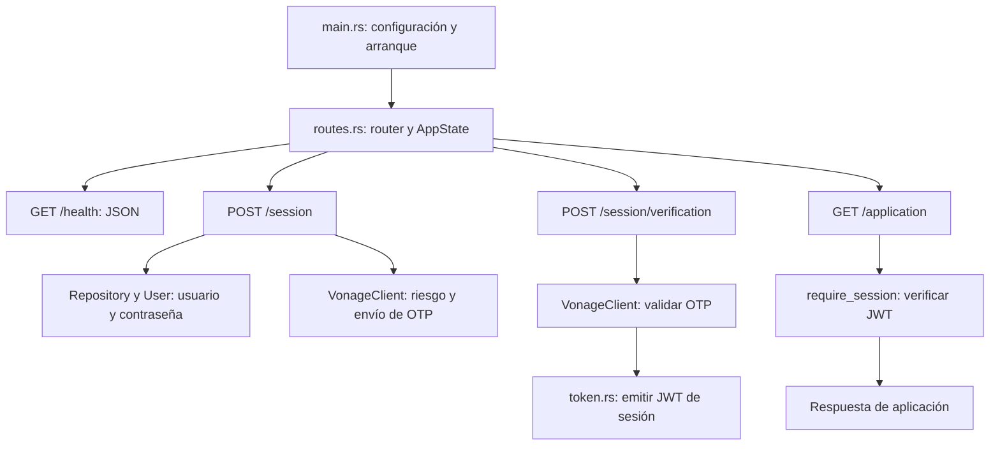

# Rock Solid: guía de estudio en español

Este repositorio construye un servidor HTTP en Rust con Axum y Tokio. Empieza con una respuesta JSON y termina con un ejemplo de login con contraseña, verificación por SMS, JWT y rutas protegidas.

La versión de código que estás revisando procede de la rama `develop` de [jdortiz/rock-solid](https://github.com/jdortiz/rock-solid), commit [`48d6073`](https://github.com/jdortiz/rock-solid/commit/48d6073). Los archivos de `src/`, `Cargo.toml` y `Cargo.lock` conservan esa solución del profesor, Jorge D. Ortiz Fuentes. Esta guía y la carpeta `docs/` añaden las explicaciones educativas. En esta copia, `main` contiene la solución y la documentación guardadas en commits; se conserva la [licencia Apache 2.0 original](LICENSE.txt).

## Empieza por aquí

1. [Servidor HTTP, Tokio, crates y JSON](docs/01-servidor-y-json.md).
2. [Repository, usuarios, estado, Arc y dyn](docs/02-repositorio-y-estado.md).
3. [JWT, tracing y manejo de errores](docs/03-jwt-tracing-y-errores.md).
4. [OTP, Vonage y middleware](docs/04-otp-vonage-y-middleware.md).
5. [Cómo ejecutar, probar y revisar los cambios](docs/05-probar-y-revisar.md).

Lee un capítulo junto al archivo de código que explica. En VS Code puedes abrir el Markdown con la vista previa (`Ctrl+Shift+V`) y mantener el código al lado.

## Cómo se conectan las piezas



Las operaciones que fallan devuelven `AppError`; Axum lo convierte en una respuesta HTTP. `tracing` registra información de las peticiones. El diagrama muestra el flujo final: en la etapa 03 se emitía un JWT inmediatamente después de la contraseña; las etapas de OTP cambian ese comportamiento.

## Qué hace cada archivo

| Archivo | Responsabilidad | Qué aprender |
| --- | --- | --- |
| [src/main.rs](src/main.rs) | Carga `.env`, configura logs, crea el repositorio y arranca el servidor | `async`, `.await`, configuración y composición |
| [src/routes.rs](src/routes.rs) | Declara rutas, estado, peticiones, respuestas y middleware | Handlers, extractores, JSON y flujo HTTP |
| [src/repository.rs](src/repository.rs) | Define `Identifiable`, `Repository` e implementación en memoria | Traits, genéricos e inversión de dependencias |
| [src/user.rs](src/user.rs) | Representa usuarios y comprueba hashes de contraseña | Encapsulación y bcrypt |
| [src/token.rs](src/token.rs) | Genera y valida JWT; lee claves del entorno | Claims, firma, expiración y `anyhow` |
| [src/app_error.rs](src/app_error.rs) | Traduce fallos internos a estados y mensajes HTTP | `Result`, `?`, `From` e `IntoResponse` |
| [src/vonage.rs](src/vonage.rs) | Llama a Verify e Identity Insights | Cliente HTTP reutilizable y servicios externos |
| [Cargo.toml](Cargo.toml) | Describe el paquete y sus dependencias | Crates y features |
| [Cargo.lock](Cargo.lock) | Fija las versiones resueltas de las dependencias | Compilaciones reproducibles; no editar a mano |
| [rust-toolchain.toml](rust-toolchain.toml) | Pide Rust estable, rustfmt y clippy | Entorno de desarrollo |
| [rustfmt.toml](rustfmt.toml) | Configura el formato para edición 2024 | Estilo uniforme |
| [.devcontainer/devcontainer.json](.devcontainer/devcontainer.json) | Prepara el entorno de Codespaces/dev containers y el puerto 8080 | Desarrollo dentro de un contenedor |
| [generate-env.sh](generate-env.sh) | Genera claves RSA y escribe `.env` | Clave privada y pública; requiere zsh y OpenSSL |
| [curl_tests/](curl_tests/) | Contiene peticiones de ejemplo para probar la API | Observar estados, cabeceras y cuerpos HTTP |
| [.gitignore](.gitignore) | Excluye `target`, archivos `.env` y copias `*~` | Separar compilación, secretos y código versionado |
| [INSTRUCTIONS.md](INSTRUCTIONS.md) | Guion original del profesor | Construcción paso a paso |
| [README.md](README.md) | Preparación y checkpoints originales | Orientación general del taller |
| [SECURITY.md](SECURITY.md) | Canal definido por el autor para reportar problemas | Reporte de vulnerabilidades |
| [LICENSE.txt](LICENSE.txt) | Licencia Apache 2.0 del proyecto | Condiciones de uso del código original |

## Orden de las lecciones

En el repositorio original, `main` es el punto de partida y `develop` contiene el resultado acumulado. En esta copia educativa, `main` ya contiene la solución y las explicaciones. Las etiquetas siguientes son fotografías de cada etapa del repositorio original; solo estarán disponibles localmente si las has importado. Usa `milestone/00-start` como referencia del inicio al comparar la solución.

| Etiqueta | Aprendizaje |
| --- | --- |
| `milestone/00-start` | Proyecto inicial |
| `milestone/01-basic-server` | Tokio, Axum, `/health` y JSON |
| `milestone/02-user-repository` | Usuarios, bcrypt, traits y estado compartido |
| `milestone/03-session-jwt` | Login con contraseña y JWT |
| `milestone/04-tracing` | Logs y seguimiento de peticiones |
| `milestone/05-error-handling` | Respuestas de error uniformes |
| `milestone/06-verify-start` | Inicio de la verificación por SMS |
| `milestone/07-verify-check` | Validación del código OTP |
| `milestone/08-identity-insights` | Comprobación de riesgo por cambio de SIM |
| `milestone/09-protected-endpoint` | Validación de JWT en un endpoint |
| `milestone/10-middleware` | Protección de rutas mediante middleware |
| `milestone/complete` | Solución del taller |

Si has importado las etiquetas originales (consulta [README.md](README.md#workshop-checkpoints)), puedes consultar una etapa sin cambiar tu trabajo local:

```sh
git show milestone/02-user-repository:src/repository.rs
git diff milestone/01-basic-server milestone/02-user-repository -- src
```

El primer comando muestra un archivo. El segundo muestra qué añadió esa lección. Consulta [el capítulo de revisión](docs/05-probar-y-revisar.md) para trabajar con Source Control.

## Dependencias de la solución

| Crate | Para qué aparece aquí |
| --- | --- |
| `tokio` | Ejecutar tareas asíncronas y escuchar conexiones TCP |
| `axum` | Rutas, extractores, middleware y respuestas HTTP |
| `serde`, `serde_json` | Convertir estructuras Rust a JSON y viceversa |
| `bcrypt` | Generar y verificar hashes de contraseña |
| `jsonwebtoken` | Firmar y verificar JWT |
| `anyhow` | Propagar errores de distintas operaciones con un tipo común |
| `thiserror` | Derivar implementaciones de error para `AppError` |
| `dotenvy` | Cargar variables desde `.env` durante desarrollo |
| `reqwest` | Hacer peticiones HTTP a Vonage |
| `tracing`, `tracing-subscriber` | Emitir y presentar eventos y spans |
| `tower-http` | Capa de tracing HTTP |
| `uuid` | Generar el identificador `jti` del JWT de Vonage |

## Alcance de esta versión

Es una solución educativa. Guarda usuarios en memoria y utiliza un usuario de demostración. La verificación OTP acepta un `username` del cliente: el propio código advierte que falta vincular el desafío al usuario en el servidor. La ruta privada exige un JWT válido, pero no implementa permisos por rol.

Los capítulos distinguen lo que hace el código de las mejoras sugeridas por el taller. Las comprobaciones `live` y `ready` son valores constantes; no comprueban la disponibilidad de Vonage ni de una base de datos.

El capítulo 5 indica cómo preparar el entorno y qué resultados esperar. Las respuestas esperadas son una guía de comprobación; verifica la compilación y las peticiones HTTP en tu propio entorno.
